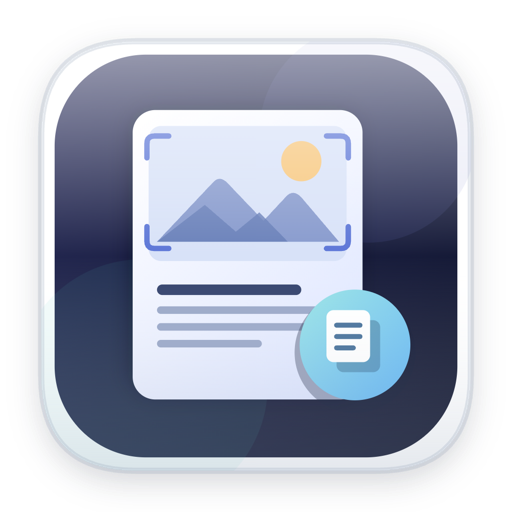

<div align="center">



# CopyText

**Copy text out of any website — including the ones that block it.**

Press <kbd>⌥⌘S</kbd>, drag a box over the text, paste. OCR runs entirely on your Mac.


</div>

---

## The problem

Plenty of sites refuse to let you take the text you can plainly see:

- `user-select: none` — selection is dead, ⌘C copies nothing
- `contextmenu` / `copy` event handlers — right-click and copy are hijacked
- Text rendered into `<canvas>`, a `<video>`, a PDF viewer, or as an image

Every one of those is a *presentation* trick. The pixels are still on your screen,
and pixels can be read back. CopyText takes a screenshot of the region you select
and turns it into text you can copy.

## How it works

One executable, one source file, three Apple frameworks. No third-party code.

### The pipeline

```
user presses ⌥⌘S
      │
      ▼
Carbon hot key ────────────────►  hotKeyEventHandler    (C callback, hops to main queue)
      │
      ▼
copyTextFromScreen()                                    (@MainActor)
      │
      ├─► CGPreflightScreenCaptureAccess() ── denied ───► alert + Basso, stop
      ▼
screencapture -i -x -o $TMPDIR/copytext-<uuid>.png      (Esc → nil, stop)
      │
      ▼
recognizeText(in:) ────────────►  Vision, .accurate     (on-device, ~0.35 s)
      │
      ▼
NSPasteboard.general ◄── text     Tink, temp file deleted
```

Total time from releasing the mouse to text on the clipboard is roughly **0.35 s**
for a typical region, measured on an M1 Max (0.01 s of that is process start, so
practically all of it is recognition).

### 1. The global hotkey (Carbon, not NSEvent)

`registerHotKey()` installs a Carbon hot key (`RegisterEventHotKey`) for <kbd>⌥⌘S</kbd>
with the signature `'CTXT'`, and registers `hotKeyEventHandler` through
`InstallEventHandler` on the application event target.

Why Carbon and not `NSEvent.addGlobalMonitorForEvents`? A global event monitor
requires the **Accessibility** permission, which is a much bigger trust ask than
Screen Recording, and it is fragile across macOS releases. A Carbon hot key needs
no extra permission, and registration is all-or-nothing: if another app already
owns <kbd>⌥⌘S</kbd>, `RegisterEventHotKey` returns an error and CopyText says so
instead of leaving you pressing a key that does nothing.

The handler is a C function pointer, so it cannot capture Swift state. It reaches
the controller through a file-private `nonisolated(unsafe) weak` global and hops to
the main queue before doing anything. The `unsafe` is deliberate and documented:
Carbon invokes the handler on the main thread, so the access is already serialised.

### 2. Screen capture (shelling out to `screencapture`)

`ScreenCapture.captureRegion()` runs `/usr/sbin/screencapture -i -x -o <tmpfile>`:

| Flag | Effect |
| --- | --- |
| `-i` | interactive rectangle selection, drawn by the WindowServer |
| `-x` | no shutter sound |
| `-o` | no window drop shadow |

This is a deliberate trade. `ScreenCaptureKit` would keep everything in-process, but
it needs several hundred lines of stream configuration plus its own selection UI.
`screencapture` gives us the crosshair the user already knows from <kbd>⌘⇧4</kbd>,
for about ten lines of code, and it is the same component macOS itself uses.

The child's exit status is the cancel signal: **a non-zero exit means no capture happened**
(pressing Esc during selection), and `captureRegion` returns `nil`, which
`copyTextFromScreen` treats as a no-op rather than an error. On success the file's
permissions are forced to `0600` and the caller deletes it in a `defer`, so a
screenshot never outlives the operation — including on the throwing path.

### 3. Reading the pixels (Vision)

`recognizeText(in:)` loads the PNG into an `NSImage`, converts it to a `CGImage`,
and runs a single `VNRecognizeTextRequest` through `VNImageRequestHandler`:

| Setting | Value | Why |
| --- | --- | --- |
| `recognitionLevel` | `.accurate` | Higher-quality model; measured ~2× slower than `.fast` |
| `usesLanguageCorrection` | `true` | Word-level correction for odd spacing and ambiguous letter pairs |
| `recognitionLanguages` | `["en-US"]` | One language keeps it fast; add more here |

On a clean screen-text test image, `.fast` produced byte-identical text in about
70 ms versus 155 ms for `.accurate`, so `.accurate` is not free. It is kept as the
default because it degrades less on low-contrast and noisy captures — that trade is
a judgement call, not a measured win on clean screenshots. If you mostly OCR crisp
UI text and want it faster, switch the level to `.fast`.

Vision does not return paragraphs — it returns **one observation per text line**,
each with a normalised `boundingBox` in a coordinate space whose origin is the
**bottom-left**. Turning that into text in reading order is our job:

```swift
let observations = (request.results ?? []).sorted { lhs, rhs in
    let dy = lhs.boundingBox.midY - rhs.boundingBox.midY
    if abs(dy) > 0.01 { return dy > 0 }   // descending midY == top to bottom
    return lhs.boundingBox.minX < rhs.boundingBox.minX  // same row: left to right
}
```

Two details matter. Sorting by `midY` rather than `minY`/`maxY` keeps rows stable
when one line has a descender (`g`, `y`, `p`) and its neighbour does not. The `0.01`
tolerance (1% of image height) treats lines that are visually on the same row as
ties, so a short line next to a taller one is not pushed above it. Then
`topCandidates(1).first` takes Vision's best transcription of each line and the
lines are joined with `\n`.

If every candidate is blank, `recognizeText` throws `OcrError.noText` instead of
returning `""` — this is what stops a misfired capture from silently wiping the
clipboard with nothing.

### 4. Putting it on the clipboard

`copyTextFromScreen` clears `NSPasteboard.general` and writes a plain `.string`, so
the result pastes cleanly into any app, with no styling carried over. Feedback is
audible rather than a window: *Tink* on success, *Basso* on failure, silence when
the user cancelled — three distinct outcomes, no UI to dismiss.

### 5. Concurrency model

Everything runs on the main thread: `AppController` is `@MainActor`, and the whole
capture → OCR → pasteboard sequence happens inside one call. There is no shared
mutable state and no locks. The `isBusy` flag drops hotkey presses that arrive
while a capture is in flight, so two selections cannot interleave.

The cost of that simplicity: recognition blocks the main run loop for its
duration, so the menu bar is unresponsive for those ~0.3 s. That is a deliberate
trade — moving OCR to a background task would add cancellation and lifetime
handling for no perceptible gain at this size. It becomes worth doing if
recognition ever exceeds roughly half a second.

### 6. Permissions, bundles and signing

Screen capture requires the **Screen Recording** (TCC) permission. The app checks
it with `CGPreflightScreenCaptureAccess()` on every run and only calls
`CGRequestScreenCaptureAccess()` — which triggers the system prompt — at launch, so
the user is not nagged mid-task. If it is still denied, the app explains itself and
offers a button that deep-links to the right System Settings pane.

This is why `build.sh` produces a real `.app` bundle rather than a bare binary:

- `LSUIElement = true` in `Info.plist` makes it a menu bar accessory — no Dock icon.
- TCC identifies an app by its **bundle identifier and code signature**. `codesign
  --sign - --identifier com.local.copytext` ad-hoc signs it, so the grant survives
  relaunches. Run the binary out of the build directory instead and macOS treats
  every launch as a new app.

### Code map

| Symbol | Responsibility |
| --- | --- |
| `recognizeText(in:)` | Image → reading-ordered text via Vision |
| `OcrError` | `.unreadableImage`, `.noText` |
| `ScreenCapture.hasPermission(prompt:)` | TCC preflight, optional system prompt |
| `ScreenCapture.captureRegion()` | Interactive selection, `nil` on cancel |
| `AppController.applicationDidFinishLaunching` | Status item, menu, hot key, first-run permission |
| `AppController.registerHotKey()` | Carbon hot key registration |
| `AppController.copyTextFromScreen()` | The pipeline above |
| `hotKeyEventHandler` | Carbon → main-queue hop |
| `--ocr <path>` | Same OCR path, CLI entry for scripting and tests |

### Build pipeline

`build.sh` runs `swift build -c release`, copies the binary and `Info.plist` into
`dist/CopyText.app/Contents/`, adds the icon, and ad-hoc signs the bundle. With
`UNIVERSAL=1` it passes `--arch arm64 --arch x86_64` to SwiftPM and packages the
fat binary SwiftPM produces. There is no Xcode project and no `xcodebuild` step.

## Install

Requires **macOS 13+**. To build from source you also need the Xcode command line
tools (`xcode-select --install`).

```sh
git clone https://github.com/sambitar/argos-panoptes.git && cd CopyText
./build.sh
open dist/CopyText.app
```

Apple Silicon only? `./build.sh`. Shipping to Intel Macs too?
`UNIVERSAL=1 ./build.sh` produces a fat `arm64` + `x86_64` binary.

### First launch: Screen Recording permission

macOS will not show the region selector until the app is allowed to capture the
screen. On first launch CopyText asks for it — approve, then relaunch:

> **System Settings → Privacy & Security → Screen Recording → enable CopyText**

The build is ad-hoc signed. If you downloaded a prebuilt copy, the first launch
may be blocked by Gatekeeper:

```sh
xattr -d com.apple.quarantine /Applications/CopyText.app
```

or right-click the app → **Open** → **Open** again.

## Usage

| Action | Result |
| --- | --- |
| <kbd>⌥⌘S</kbd> | Select a region on screen and copy its text |
| Menu bar icon → **Copy Text from Screen** | Same thing, mouse only |
| <kbd>Esc</kbd> during selection | Cancel |
| Menu bar icon → **Quit CopyText** | Quit (<kbd>⌘Q</kbd>) |

The text lands on the clipboard the moment you finish the selection — no extra
window, no "copy" button. A soft *Tink* means it worked; a *Basso* means the
region held no readable text.

CopyText lives in the menu bar only. No Dock icon, no windows.

### From the command line

```sh
dist/CopyText.app/Contents/MacOS/CopyText --ocr screenshot.png
```

Prints recognised text to stdout, exits `1` on failure. Handy for scripting:

```sh
CopyText --ocr shot.png | pbcopy
```

## Privacy

- **No network.** The executable contains no HTTP client. Verify it yourself —
  both of these print `0`:

  ```sh
  strings dist/CopyText.app/Contents/MacOS/CopyText | grep -c 'https\?://'
  nm -u dist/CopyText.app/Contents/MacOS/CopyText | grep -c 'URLSession\|nw_connection'
  ```
- **No telemetry, no analytics, no accounts.**
- **Screenshots are temporary.** Each capture is written to `$TMPDIR` with mode
  `0600` and deleted immediately after recognition.
- Recognition runs locally on the Neural Engine. Nothing is uploaded, ever.

## Configuration

Everything is in `Sources/CopyText/main.swift` — one file, no config format.

| What | Where |
| --- | --- |
| Hotkey (currently <kbd>⌥⌘S</kbd>) | `RegisterEventHotKey` in `registerHotKey()` |
| OCR languages | `request.recognitionLanguages` — add `"de-DE"`, `"ja-JP"`, … |
| Speed vs. accuracy | `request.recognitionLevel` — `.fast` or `.accurate` |
| Menu bar symbol | `NSImage(systemSymbolName:)` in `applicationDidFinishLaunching` |

Rebuild with `./build.sh` after any change.

## Project layout

```
Sources/CopyText/main.swift   OCR, capture, hotkey, menu bar — the whole app
Resources/Info.plist          bundle metadata (LSUIElement = menu bar only)
Resources/AppIcon.icns        app icon, 10 sizes
assets/icon.png               icon for this README
tools/make-icon.swift         turns flat artwork PNGs into a macOS .icns
test/ocr-smoke.sh             OCR smoke test
test/fixture.png              screenshot the smoke test reads
build.sh                      build + bundle + ad-hoc sign
```

## Tests

```sh
./test/ocr-smoke.sh
```

Asserts that the OCR result preserves line order and line count, and that a blank
image or a missing file fails loudly instead of quietly copying an empty string.

## Known limits

| Limit | Detail |
| --- | --- |
| English only | Add locales via `recognitionLanguages` |
| Multi-column layouts | Lines are emitted top-to-bottom, left-to-right — not column by column |
| Em dashes | Often recognised as `-` at typical screen font sizes |
| Handwriting / low contrast | Vision handles these poorly; use a sharper screenshot |
| Region selector | Provided by `/usr/sbin/screencapture`, so it looks like the system one |
| Blocks the menu bar during recognition | Everything runs on the main thread for ~0.3 s |

## Troubleshooting

**Nothing happens when I press ⌥⌘S.** Check Screen Recording permission first.
If CopyText is already ticked there, remove it from the list with `−` and re-add
it — the grant is tied to the code signature, so a rebuilt app may need re-approval.

**The selection appears but the clipboard stays empty.** That is the `Basso` path:
the region had no readable text. Try a larger region with more contrast.

**"⌥⌘S is already taken".** Another app registered the shortcut. Use the menu bar
icon, or change `kVK_ANSI_S` in `registerHotKey()` and rebuild.

**The first capture after install is slow.** macOS compiles the Vision model on
first use. Warm captures take ~0.3 s; the first one can take noticeably longer.

**I granted permission but macOS still refuses.** Launch the app from Finder or
`open dist/CopyText.app` — running the raw binary from a terminal makes TCC treat
each launch as a different app.

## Roadmap

- [ ] Keep a rolling history of the last N captures
- [ ] Capture the focused window directly, no dragging
- [ ] Auto-detect the dominant language
- [ ] Launch at login
- [ ] Menu bar item shows a brief ✓ on success

## Contributing

Issues and pull requests are welcome. Keep changes small and in the existing
style: one executable target, no third-party dependencies, no networking.

## License

[MIT](LICENSE) © 2026 Reshd Bitar
